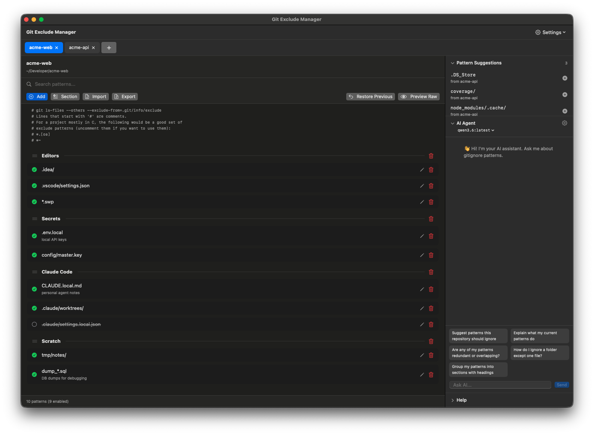

<p align="center">
  
</p>

# Git Exclude Manager

A native macOS app for editing **`.git/info/exclude`** — the per-clone ignore file that is never committed.
Keep your editor folders, local notes and secrets out of `git status` without touching the team's `.gitignore`.
English and Thai UI.

<p align="center">
  
</p>

Same window layout as [Hosts Manager](https://github.com/gomin2013/hosts-manager) — a sibling app for editing
`/etc/hosts` ([website](https://gomin2013.github.io/hosts-manager/)). If you use one, you already know the other.

## Features

- **Visual editor** — add, edit, enable/disable (`#pattern`), search and delete patterns. Every save is atomic
  and keeps a backup; **Restore Previous** undoes the last save.
- **Your file stays yours** — comments, blank lines and unknown lines are written back byte-for-byte.
- **Sections** — blank lines become draggable section breaks with an optional `# heading`; drag anything to reorder.
- **Multiple repositories** — browser-style tabs (drag to reorder, ⌘1…⌘9, ⌃Tab), restored on relaunch.
- **Pattern Clipboard** — ⌘-click / ⇧-click to select patterns, ⌘C to collect them, paste into another
  repository (only missing ones are added).
- **Pattern Suggestions** — patterns your other repositories use that this one doesn't, one click to add.
- **AI Agent (optional)** — chat about your patterns, Quick Messages and ✨ Generate Comment with
  Apple Foundation Models, Ollama, OpenAI, Gemini or Claude. API keys live in the Keychain.
- **Import / Export** — import any text file including `.gitignore` (merge or replace).

## Install

### Download (recommended)

1. Download `GitExcludeManager-x.y.z.dmg` from [**Releases**](../../releases/latest)
   (optionally verify it: `shasum -a 256 -c SHA256SUMS.txt`).
2. Open the DMG and drag **Git Exclude Manager** to **Applications**. Run it from Applications, not from the DMG.
3. **First launch** — the app is not yet notarized by Apple, so macOS blocks it once:
   - Open it, click **Done** on the warning, then go to **System Settings → Privacy & Security**,
     scroll to *"Git Exclude Manager" was blocked* and click **Open Anyway**; or
   - in Terminal: `xattr -dr com.apple.quarantine "/Applications/GitExcludeManager.app"`
4. Allow the background helper when macOS asks (**System Settings → General → Login Items**).
   It only reads and writes the `.git/info/exclude` files you open.

### Build from source

Requires macOS 14+ and Xcode 16+ (Xcode 26 to regenerate the macOS 26 icon).

```bash
git clone <this repo> && cd git-exclude-manager
scripts/build-app.sh && open build/GitExcludeManager.app
```

Apps you build yourself are not quarantined, so there is no Gatekeeper prompt.

## Requirements

- macOS 14 Sonoma or later
- AI is optional: cloud providers need your own API key; Ollama needs `ollama serve`;
  Apple Foundation Models needs macOS 26 with Apple Intelligence enabled

## Privacy

Files are read and written locally by a user-level helper — no root, no telemetry.
With a **cloud** AI provider, the chat sends the repository name and the current `.git/info/exclude`
content to that provider. Choose Ollama or Apple Foundation Models to keep everything on-device.

## Development

```bash
swift build && swift test                 # 80+ tests: parser, file I/O, XPC round trip, view models, AI clients
scripts/build-app.sh                      # build/GitExcludeManager.app (ad-hoc signed, helper registered on launch)
scripts/make-dmg.sh                       # build/GitExcludeManager-<version>.dmg
swift scripts/make-icon.swift             # regenerate icons from Packaging/source/
```

| Path | What |
|---|---|
| `Sources/Shared` | Models, `.git/info/exclude` parser/serializer, file service, XPC protocol |
| `Sources/GitExcludeManagerHelper` | User-level LaunchAgent that does the file I/O over XPC |
| `Sources/GitExcludeManagerApp` | SwiftUI app: views, view models, AI service, en/th strings |
| `Packaging/` | App icon (Icon Composer + `.icns`), mascot, AI source renders |

**Releasing:** bump `CFBundleShortVersionString` in both `Info.plist` files, update `CHANGELOG.md`, then
`git tag v1.2.3 && git push origin v1.2.3`. GitHub Actions builds the DMG and opens a **draft** release.

## Troubleshooting

- **"Connection failed" errors** — the helper isn't registered. Quit and reopen the app from `/Applications`;
  check **System Settings → General → Login Items** that *Git Exclude Manager* is allowed.
- **AI says "not configured"** — open the ⚙ in the AI Agent panel and pick a provider/model.
- **Reset all app settings** — `defaults delete com.gitexcludemanager.app`

## Contributing

Issues and pull requests are welcome. Please add tests for new behavior and make sure `swift test` passes.

## License

[MIT](LICENSE) © 2026 Watthajak Jinasam
